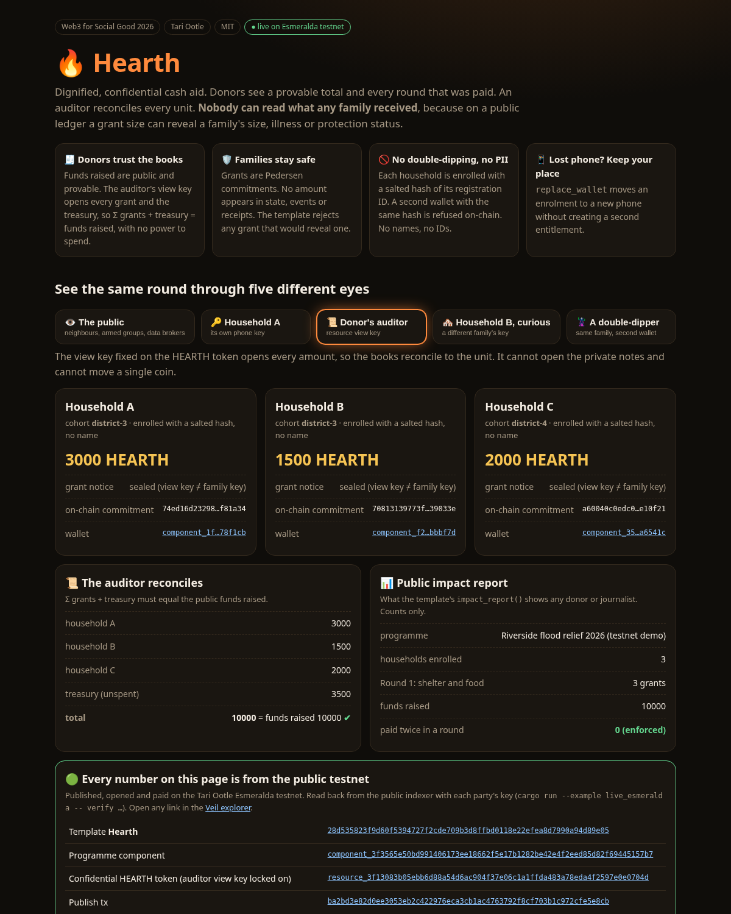

# 🔥 Hearth: dignified, confidential cash aid on a public ledger

**Donors see a provable total. An auditor reconciles every unit. Nobody can read what any family received.**

Hearth is a [Tari Ootle](https://tari.com) template for humanitarian cash and voucher assistance. It is **live on the Esmeralda testnet** with a full aid round (enrol, open round, disburse) paid in one transaction. **Live demo:** https://xachp.github.io/hearth-aid/



## Why this matters

Cash assistance is now the fastest-growing form of humanitarian aid. Agencies, though, have been told plainly that putting beneficiaries on a transparent ledger can harm them:

* **A grant size is personal data.** In most cash programmes the transfer is sized by household size, disability, medical need or protection status. If an amount is public, a neighbour, landlord, militia or data broker can work out *who is vulnerable and how*. The ICRC *Handbook on Data Protection in Humanitarian Action* and GDPR Art. 9 both treat this as sensitive data. "Do No Harm" means it must not leak.
* **A public chain is forever.** Blockchain aid pilots publish wallet balances that cannot be deleted after a crisis ends.
* **Donors still need accountability.** Double-dipping (one family enrolled twice), ghost beneficiaries and unreconciled books are why donors ask for transparency in the first place.

Today an agency has to choose between transparency and safety. **Hearth gives each party exactly the view it needs:**

| Who | What they see | How |
|---|---|---|
| The public, neighbours, armed groups | Funds raised, the number of households and grants per round. **No amounts.** | Pedersen commitments; count-only events; `impact_report()` |
| Each household | Its own grant amount and a private note from the agency | An ElGamal-encrypted notice on its own output, opened with its own key |
| The donor's auditor | **Every** amount plus the treasury, reconciled to the unit, with **no** spending power | A view key locked onto the HEARTH resource at creation |
| Another household | Only its own grant | The same encryption, keyed per household |
| A double-dipper | A rejection | Salted-hash enrolment tags, checked on-chain |

## What the template enforces (`src/lib.rs`)

* `enrol(account, cohort, tag)`: the tag must be a **salted SHA-256 of the registration ID** (64 lowercase hex characters). Raw IDs are refused, so no PII ever reaches the chain. Any tag that has been used before is rejected (*"duplicate enrolment tag"*), even after offboarding.
* `replace_wallet(old, new)`: handles a lost or stolen phone. The household keeps its place **and** its paid-this-round status, so a new wallet never creates a second entitlement.
* `open_round(label)` / `disburse_round(grants)`: an entire round is paid **atomically** (at most 64 grants). One bad grant rejects the whole round. The only event is `RoundDisbursed { round, grants }`, a count.
* `grant(...)` rejects:
  * any grant that **reveals** an amount;
  * a household already paid this round;
  * grants before a round is open;
  * unknown or offboarded households.
* `fund(donor, ...)`: donor funding increases the **public** total `funds_raised`.
* The **auditor view key** is fixed on the resource for its lifetime, so the operator cannot issue a grant the auditor cannot read.

## Live on the Esmeralda testnet

| Step | Link |
|---|---|
| Template `Hearth` | [`28d53582…4d89e05`](https://explorer.tari.mw/template/28d535823f9d60f5394727f2cde709b3d8ffbd0118e22efea8d7990a94d89e05) |
| Publish tx | [`ba2bd3e8…e5e8cb`](https://explorer.tari.mw/tx/ba2bd3e82d0ee3053eb2c422976eca3cb1ac4763792f8cf703b1c972cfe5e8cb) |
| Open programme: 10,000 raised, 3 household wallets | [`2a067587…f0dac3`](https://explorer.tari.mw/tx/2a067587a87600a6c0d75bcbdabc0ebe01cb3b4381d8461f8a5d61099ff0dac3) |
| **Round 1 in one tx: enrol ×3, open_round, disburse_round** | [`fe399877…be94d2b`](https://explorer.tari.mw/tx/fe39987741d91b97046e516e47806fd89ac8e644fd12525e1a664423fbe94d2b) |
| Programme component | [`component_3f3565e5…`](https://explorer.tari.mw/substate/component_3f3565e50bd991406173ee18662f5e17b1282be42e4f2eed85d82f69445157b7) |
| Confidential HEARTH resource | [`resource_3f13083b…`](https://explorer.tari.mw/substate/resource_3f13083b05ebb6d88a54d6ac904f37e06c1a1ffda483a78eda4f2597e0e0704d) |

Read back from the public indexer with each party's own key (`docs/live/verify.json`):

* Household A's key opens its own notice: **3000**. B's opens **1500**, C's opens **2000**. None can open another household's notice.
* The auditor's view key reads 3000 + 1500 + 2000 + treasury 3500 = **10,000 = funds raised ✔**.
* A dry run that tries to enrol Household A again under a second wallet is **rejected by the live component**: `Household is already enrolled (duplicate enrolment tag)`.

## Run it

```bash
rustup target add wasm32-unknown-unknown
cargo build --release --target wasm32-unknown-unknown   # the template
cargo test                                              # 20 engine tests
# live client (needs a running tari_ootle_walletd on Esmeralda):
cargo run --example live_esmeralda -- init | new | round | dupe | verify
python3 docs/build_page.py                              # rebuild the demo page from docs/live/*.json
```

### The 20 tests

**`tests/aid.rs`**

* grant sizes are hidden but the auditor reconciles every unit
* the same household cannot enrol twice under two wallets
* raw IDs are refused; only salted hashes go on chain
* no household is paid twice in a round
* a lost phone moves the enrolment without a second entitlement
* offboarded households keep their tag and cannot re-enrol
* revealed grants are rejected, so a family is never exposed
* the operator cannot hide a grant from the auditor
* outsiders cannot enrol themselves or pay out
* donor funding grows the public total only
* grants cannot be paid before a round opens

**`tests/privacy.rs`**

* a family reads its own grant notice from the chain
* the auditor sees amounts but never the private notice
* neighbours cannot see each other's grants
* a whole round is paid atomically with one count-only event
* one bad grant rejects the whole round
* a family can prove one grant to a landlord and nothing else
* families spend their grant confidentially at a merchant
* the operator recovers its treasury from chain state alone
* the public impact report has counts and no amounts

## Roadmap to a real pilot

1. A merchant redemption flow (voucher mode), so cash is spent at vetted shops while the auditor reconciles redemptions.
2. Multi-sig operator plus a time-locked auditor key rotation for each donor.
3. A USSD/SMS wallet front end for feature phones (most cash recipients don't own smartphones).
4. A partner pilot with a local NGO, sized with the Sphere minimum standards for cash.

See [THREAT_MODEL.md](THREAT_MODEL.md) for what Hearth does and does **not** protect against.

---
MIT licensed. Built for SMU *Web3 for Social Good 2026* (Tech Track) with the help of an AI coding agent. The confidential-grant primitives (encrypted notices, landlord proofs, treasury recovery) are adapted from my earlier MIT project *Graveyard Shift*.
